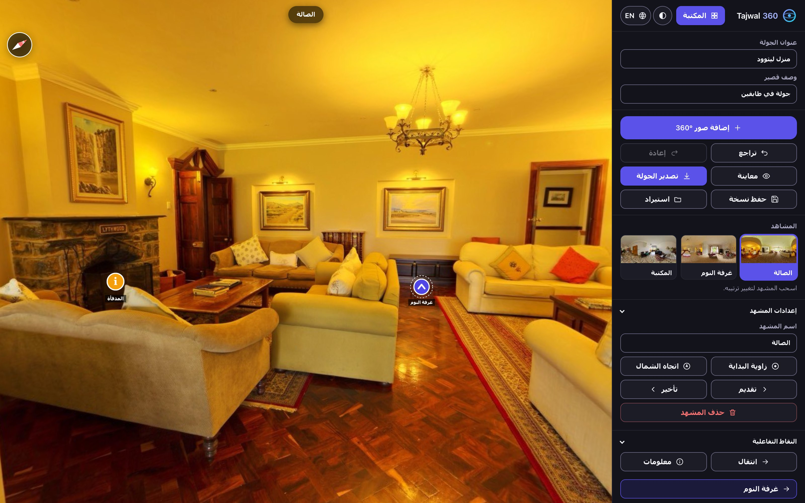

# Tajwal 360

A 360° virtual tour builder that runs entirely in the browser. Images stay on the
machine that opened the page, and a finished tour exports as one self-contained HTML
file, or as a folder of files for a large tour, that you can put on any host.

**[Open the studio →](https://yousef-dev921.github.io/tajwal-360/)**



The interface comes in Arabic (RTL) and English (LTR), with an auto/light/dark theme
switch. Both choices persist in `localStorage` and are applied before the first paint,
so a return visit never flashes the wrong theme or direction.

<p dir="rtl" lang="ar">
<b>بالعربية:</b> Tajwal 360 استوديو لبناء جولات افتراضية بصور &#x2066;360°&#x2069; يعمل بالكامل
داخل المتصفح. تبقى الصور على جهازك ولا تُرفع إلى أي خادم، وتُصدَّر الجولة في ملف HTML واحد
يمكن نشره على أي استضافة. الواجهة متاحة بالعربية والإنجليزية، مع مظهر فاتح وداكن.
</p>

## Trade-offs

Everything is served as static files, which keeps hosting free and removes CDN
dependencies. Three.js is vendored locally, so the editor works offline.

The cost is that a project lives in one browser profile. Clearing site data, private
browsing, or moving to another machine loses it, and Safari deletes a site's storage after
seven days of browsing without a visit. The editor is explicit about this: it reports when
storage is unavailable, warns before the quota fills, and periodically prompts for a backup
download. When images are first added it asks the browser for persistent storage, and if
that isn't granted it says once per session that the browser may clear the work.

## Features

### Editing
- Load several panoramas at once, by file picker or drag-and-drop. Anything wider than
  4096px is downscaled; anything that is not roughly 2:1 is placed as a flat panel
  instead of being stretched across the sphere.
- High-resolution panoramas, a project option under Viewing options. While it is on, a
  panorama wider than 4096 px also keeps a master of up to 8192 px, and the 4096 px copy is
  drawn from that master. Desktops show the master; phones, tablets and any GPU that can't
  hold an 8192 texture show the 4096 px copy and never download or decode the master. It is
  a project setting rather than a choice per import because it describes the tour being
  made, and it applies to images added after it is turned on: an image already reduced to
  4096 px can't be enlarged again. The folder export carries both sizes; the single HTML
  file carries the 4096 px copies only, and says so.
- Link hotspots and info hotspots, in seven shapes (including a floor spot, a marker lying
  on the floor with a soft beam of light), as text only, or with an icon of your own.
  Colour and size are adjustable. Drag a hotspot in the panorama to move it.
- Your own icons: PNG, WebP, GIF, JPEG or SVG, up to 2 MB, kept in the project as PNG at
  up to 256px with their transparency. SVG is drawn into a PNG on upload too, because a
  vector image drawn onto a canvas can stop that canvas being uploaded to the GPU in some
  browsers. A saved or exported file carries only the icons in use.
- Labels run over several lines and have their own text size, on a dark box or with an
  outline only. A text-only info hotspot with no further text is a plain note on the
  scene, for naming a wall, a material or a defect; in the tour it doesn't react to
  clicks, since a popup would only repeat it.
- An arrow or a custom icon can point in any direction, in 5° steps.
- A hotspot can keep its size on screen when the view zooms, instead of growing with the
  panorama.
- Copy a hotspot (Ctrl+C) and paste it into any scene (Ctrl+V), where it appears in the
  middle of the view; duplicate it beside itself (Ctrl+D); remove it with Delete. A link
  pasted into its own destination turns into a link back to the scene it came from, which
  is what a return arrow needs.
- A new hotspot takes the look of the last one of its kind that was edited, so a tour of
  many scenes needs its arrows styled once.
- Glyphs on light icon colours, such as white, are drawn dark so they stay visible.
- 60 steps of undo and redo.
- Scene thumbnails, drag-to-reorder, rename and delete.
- Tours of more than 12 scenes get a search field over the scene list and over a link's
  list of destinations. Search ignores case, accents and Arabic diacritics, treats the alef
  forms (أ إ آ ا) as one, and finds a scene by its number in the tour as well as by name.
  Scenes can still be dragged to a new place while the list is filtered; on Enter, the
  destination search takes its first match.
- A company logo in any corner of the tour, over every scene, with adjustable size and
  opacity. Drag it on the panorama and it snaps to the nearest corner; it moves the title
  row, the compass and the scene bar out of its way. PNG, WebP and SVG keep their
  transparency, and a logo with a solid background gets a warning.
- Scene audio: each scene can have its own clip, such as a narration of the room, up to
  8 MB, with a loop option and a delay of 0 to 30 seconds. The editor plays it on demand
  with a Listen button.
- Nadir patch to cover the tripod, background audio, and a floor plan with one marker
  per scene. The plan is kept at up to 4096px, as PNG so thin lines and small text stay
  sharp (a scanned or photographic plan whose PNG would pass 3 MB is stored as JPEG). It
  opens full-stage with wheel, pinch and button zoom, and scenes are placed on the
  enlarged plan.
- The capture date and GPS position are read from each JPEG's Exif block before the image
  is re-encoded. The editor shows them in the scene settings; the tour shows them, with a
  map link, only when "Show capture date and location" is on, and an exported tour leaves
  them out entirely while it is off. Altitude is not read: camera GPS heights are too rough
  to put next to survey levels.
- Per-scene start view and north direction. The start view keeps the zoom too, and it
  comes back exactly as it was set, level correction or not.
- Level correction for a photo shot off level. Each press of the rotate buttons turns the
  scene by a quarter of a degree about the direction you face, laid flat on the horizon,
  so it tilts without spinning; holding a button keeps turning, and guide lines show
  over the panorama. Straighten a vertical edge in front, then one a quarter turn away.
  The hotspots and the tripod patch turn with the photo, so they stay on what they mark.
- A cover image: the current view, taken at 1280 × 720 without hotspots. It is the
  background of the exported tour's start screen and the project's picture in the
  library, which otherwise show the first panorama squeezed flat.
- Generated `<iframe>` embed code.

### Interface
- Arabic and English, switched from the panel header. Every string lives in one
  dictionary in `app.js`; static markup is translated through `data-i18n` attributes.
- Counts go through `Intl.PluralRules`, so Arabic gets its singular, dual and plural
  forms right ("مشهد واحد", "مشهدان", "5 مشاهد", "12 مشهداً").
- User content such as scene names and hotspot labels uses `dir="auto"`, so a Latin
  file name reads correctly inside the Arabic interface and the other way round.
- Switching language sets `lang` and `dir` on the document and re-renders the dynamic
  parts.
- A three-state theme control: auto (follows the operating system), light, dark.
- An exported tour opens in the language its author used, and carries no switcher.

### Viewing
- Walkthrough transitions: the camera turns toward the hotspot, pushes in, then
  cross-fades to the next scene while preserving heading. When both scenes have a north
  direction, the compass heading carries over. Otherwise, when the next scene has a link
  back, the visitor arrives facing away from it, turned by as much as they were looking
  away from the hotspot they took; so return links keep the sense of direction with no
  setup. Failing both, the next scene opens at its start angle.
- A start screen built from the first scene.
- A scene bar with a counter (48/143) and a grid of every scene, with thumbnails and the
  same search as the editor. The grid is a dialog: arrow keys move through it, Enter opens
  a scene, Escape closes it, and focus goes back to the button that opened it. A scene
  chosen there opens directly, without the walk, since it is a jump rather than a step.
  - Up to 12 scenes, the bar also names every scene, so each is one tap away.
  - A longer tour shows previous and next buttons instead. A row of 143 names would have to
    be scrolled to find where you are, and each name is a blurred glass button that a
    phone redraws every frame. Previous and next follow the tour's order, which in a survey
    is usually the route walked on site. With the grid, they are also how a keyboard reaches
    every scene, since the hotspots on the panorama can't take focus.
- Click anywhere, an option under Viewing options, off by default. A click in the tour that
  misses every hotspot takes the link hotspot that lies most nearly in its direction, and
  walks there. Directions are compared after level correction, with heights counting half
  as much as bearings: how far below the horizon a floor arrow sits mostly says how far
  away it is, while its bearing is where the visitor wants to go. A link more than 60° from
  the click is never taken. That is about the edge of a 16:9 screen at the default zoom,
  so the walk always turns toward something the visitor can see. Before the click, the
  hotspot it would take grows under the pointer, as on hover. A drag, a pinch, a click on
  a plain text note and a click with any button but the main one never trigger it.
- Neighbouring scenes are preloaded.
- Panoramas in GPU memory stay within a budget of pixels: eight 4096 × 2048 panoramas, or
  four on touch devices, with an 8192 × 4096 one counting as four. Older ones are released
  and decoded again when revisited; the current scene and a walk in progress never are.
  Each 4096 panorama is 32 MB, and Safari on iOS reloads a page that holds much more than
  about 600 MB, so without the limit a long tour would crash on an iPhone. Preloading fills
  only what the budget leaves beside the current scene.
- Decodes take turns, one at a time on touch devices and two elsewhere, and the scene the
  visitor is waiting for jumps ahead of preloads.
- An exported tour shows its title and a loading indicator while the file downloads.
- A scene's clip starts when the visitor enters the scene, after its delay, and stops when
  they leave. The background music fades down to a quarter of its volume while the clip
  plays and back up when it ends. Nothing plays before the visitor's first tap or click,
  as browsers require, nor behind the start screen. The mute button silences both, and a
  clip resumes where it was when sound comes back on. This works in Preview, in both
  exports and in VR mode.
- Pinch zoom on touch, wheel zoom on desktop, and full keyboard control.
- Device gyroscope, and WebXR VR mode with an in-headset info panel.

### Projects
- A project library with thumbnails and timestamps.
- Autosave that reports failures instead of hiding them.
- Export to a standalone HTML tour or to a folder (ZIP) for a web host, and save and
  import projects as `.json`. See [Exporting a tour](#exporting-a-tour).

## Try it

[`samples/`](samples/) holds three CC0 panoramas. Drop them on the editor to build a
tour without needing your own 360° photos.

## Exporting a tour

There are two exports, side by side in the panel.

**Export HTML** writes one file with everything inside it: code, styles and every image as
base64. It opens anywhere, straight from disk included, which suits a small tour sent by
email. Base64 adds a third to every image and the browser has to read the whole file before
the first scene shows, so the editor estimates the size first. Past 100 MB it says how large
the file would be and suggests the folder export; a second click exports it anyway.

**Export as folder (ZIP)** writes a ZIP that unpacks to:

```
index.html          the page, with its own content security policy
README.txt          how to publish and preview it, in English and Arabic
tour/style.css      the same code as the editor, cached by the browser between visits
tour/three.min.js
tour/app.js
tour/data.js        the tour document; it sets window.__TOUR__ as the single file does
scenes/<id>.jpg     one file per panorama
audio/music.<ext>   background music
audio/<id>.<ext>    each scene's audio clip
icons/<id>.png      custom icons, only those in use
plan.<ext>, cover.jpg, nadir.png, logo.<ext>
```

Images stay binary, so the folder is about a quarter smaller than the single file, and a
visitor downloads only the scenes they visit, plus the neighbours the viewer preloads. The
viewer is the same `app.js` with the same code path: in the folder, a scene's `img` is a
relative path instead of a `data:` URL. `data.js` is a script rather than JSON so the page
needs no `fetch()`, and the page's policy allows scripts, styles, images and media from the
folder's own origin only. Scene thumbnails are left out, since only the editor shows them.
File names come from scene and icon ids, cleaned to letters, digits, `-` and `_`.

The ZIP is written by the editor itself, without a library: each file is stored
uncompressed (JPEG and compressed audio don't shrink), with its CRC-32 and a UTF-8 name.
It is assembled from the images' own `Blob`s, so a 150-scene export holds about 60 MB of
JavaScript memory at its peak rather than the whole archive. Without ZIP64 a ZIP holds at most
65,535 files and 4 GB; a tour past either limit is refused with a message before anything
is read. 143 scenes at 4096 px come to roughly 300 MB as a folder, against about 400 MB as
one HTML file; with an 8192 px master each, about 2 GB.

**The folder must be served over HTTP.** Opened straight from disk, browsers such as Chrome
refuse to hand `file://` images to WebGL, so the page says so, in both languages, instead of
failing silently. Upload the unpacked folder as it is to GitHub Pages, Netlify, Cloudflare
Pages or any static host. To preview it on your own machine, run this inside the folder and
open http://localhost:8000:

```bash
python3 -m http.server 8000
```

## How projects are stored

IndexedDB database `vrtour`, object store `k`:

| Key | Contents |
| --- | --- |
| `idx` | Project list: title, scene count, timestamp, thumbnail |
| `p:<id>` | Project document, **without image bytes** |
| `b:<id>:<sceneId>` | Panorama as a binary `Blob`, at most 4096 px wide |
| `h:<id>:<sceneId>` | High-resolution master of up to 8192 px, for scenes that have one |
| `a:<id>` | Audio track as a `Blob` |
| `pl:<id>` | Floor plan image as a `Blob` |
| `cv:<id>` | Cover image as a `Blob` |
| `sa:<id>:<sceneId>` | A scene's audio clip as a `Blob` |
| `last` | Most recently opened project |

Keeping images out of the document is what makes autosave cheap. Autosave runs on
every edit, including each keystroke in the title field. With images inline, the whole
project was rewritten each time, roughly 180 KB per keystroke for two scenes. The
document is now about 4 KB, and only images that actually changed are written. Storing
them as `Blob`s rather than base64 also drops the 33% encoding overhead.

Projects written by older builds are migrated on first load, including plans that were
stored inside the document. What a migration moves out is written on the next save,
whichever way the project was opened.

## Project file format

```json
{
  "v": 1,
  "lang": "ar",
  "title": "Tour title",
  "desc": "Short description",
  "nadir": { "img": "data:image/png;base64,...", "r": 25 },
  "audio": { "src": "data:audio/mpeg;base64,...", "name": "track.mp3", "vol": 0.6 },
  "plan":  { "img": "data:image/jpeg;base64,..." },
  "cover": { "img": "data:image/jpeg;base64,..." },
  "icons": [{ "id": "k3", "name": "door", "img": "data:image/png;base64,...", "ar": 1 }],
  "logo":  { "img": "data:image/png;base64,...", "pos": "tr", "size": 14, "op": 1, "ar": 4 },
  "eurl": "https://...",
  "auto": false,
  "walk": true,
  "meta": false,
  "hd": true,
  "click": true,
  "scenes": [{
    "id": "abc123",
    "name": "Entrance",
    "img": "data:image/jpeg;base64,...",
    "th":  "data:image/jpeg;base64,...",
    "hd":  "data:image/jpeg;base64,...",
    "u0": 0.8, "p0": 0, "n": 0.25, "f0": 60,
    "lq": [0.0262, 0, 0, 0.9997],
    "pp": { "x": 0.4, "y": 0.6 },
    "taken": "2026-10-20T09:14:37",
    "gps": { "lat": 24.7136111, "lon": 46.6752778 },
    "snd": { "src": "data:audio/mpeg;base64,...", "name": "guide.mp3", "loop": true, "delay": 2 },
    "hs": [{
      "id": "x1", "type": "link", "to": "<sceneId>",
      "label": "", "text": "", "shape": "arrow",
      "color": "#4f46e5", "size": 1, "u": 0.84, "v": 0.6,
      "rot": 90, "ts": 1.2, "box": false, "fix": true
    }]
  }]
}
```

- Root `v` is the schema version. Inside a hotspot, `v` is a coordinate; the two are
  unrelated.
- `lang` is the language an exported tour opens in (`ar` or `en`). The editor ignores it
  on import and keeps its own setting.
- Hotspot `u` and `v` are equirectangular coordinates from 0 to 1: `u` horizontally
  from the left edge, `v` vertically from the top.
- A hotspot `label` may contain line breaks. `shape` is one of `arrow`, `spot`, `ring`,
  `dot`, `pin`, `star`, `info`, `none` (text only) or `img`, which names one of the root
  `icons` in an `icon` field; on import, a hotspot whose icon is missing becomes an arrow.
  The last four hotspot fields are optional
  and left out at their defaults: `rot` turns an arrow by -180 to 179 degrees, clockwise;
  `ts` scales the label text, 0.6 to 2; `box: false` draws the label with an outline
  instead of a dark box; `fix: true` keeps the hotspot's size on screen when zooming. A
  build that predates them ignores them, and shows a text-only hotspot as an arrow.
- `u0` and `p0` are the scene's starting yaw and pitch; `n` is its north offset. `f0`,
  optional, is its starting zoom as a vertical field of view from 40 to 95 degrees
  (75 when absent). `lq`, optional, is its level correction as a quaternion `[x, y, z, w]`.
- `pp` is the scene's position on the floor plan, also 0 to 1.
- Scene `hd`, optional, is the high-resolution master of up to 8192 px, beside `img` at
  4096 px. Root `hd: true` keeps high resolution on for images added later. A build that
  predates them ignores both and keeps `img`. In a folder tour's `data.js`, `img` and `hd`
  are relative paths, and the viewer picks one per device.
- `click`, optional, turns on click anywhere. It is left out while off, and only `true`
  is accepted on import.
- `taken` is the camera's local capture time, with no time zone, and `gps` the position in
  decimal degrees. Both are optional. `meta` decides whether the tour shows them; an
  exported tour carries them only when it is `true`.
- Scene `snd`, optional, is the scene's audio clip. `loop: true` repeats it while the
  visitor stays, and `delay` is the wait in whole seconds before it starts, 0 to 30; both
  are left out at their defaults. On import the clip must be a `data:audio/` URL of at most
  8 MB.
- `logo.pos` is a physical corner (`tl`, `tr`, `bl` or `br`), so the logo stays put when
  the language changes. `size` runs from 5 to 40 and scales the logo's area against the
  screen, `op` is its opacity, and `ar` its width-to-height ratio.

## Development

No build step. Serve the directory over HTTP:

```bash
python3 -m http.server 8000
```

Opening `index.html` directly shows the editor, but export will not work: it reads
`app.js`, `style.css` and `three.min.js` with `fetch`, which `file://` blocks.

```
index.html          markup, icon sprite, content security policy
boot.js             applies the stored theme and language before the first paint
style.css           design tokens, light and dark themes, RTL and LTR layout
app.js              editor, viewer, storage and the Arabic/English dictionary
vendor/three.min.js Three.js r128 (MIT)
samples/            CC0 panoramas for testing
```

When changing `app.js`, `boot.js` or `style.css`, bump the `?v=` query in `index.html`.
Without it, returning visitors keep the cached copy.

JavaScript and CSS are formatted with [Prettier](https://prettier.io), configured in
`.prettierrc.json`:

```bash
npx prettier --write app.js boot.js style.css
```

## Deployment

Static files at the root of any host. This repository deploys to GitHub Pages from
`main`. HTTPS is required, since the gyroscope and WebXR will not start without it, and
GitHub Pages, Cloudflare Pages and Netlify all provide it on free tiers.

## Security

- The editor page carries a strict content security policy: scripts load only from the
  site itself, and nothing can be sent to another server.
- An exported tour gets its own policy that blocks every network request. It works
  offline and cannot report anything back to anyone. A folder tour may load files from its
  own origin only: no other site, no `fetch()`, no inline scripts.
- An imported `.json` file is treated as untrusted. Only well-formed fields are kept,
  images must be `data:` URLs, and every value is escaped before it reaches the page.
- The embed code generator accepts only `http` and `https` addresses.

## Accessibility

Colour pairs are checked numerically: text at 4.5:1 or better (WCAG 1.4.3), control
borders and focus rings at 3:1 or better (WCAG 1.4.11). Touch targets are 44px on
coarse pointers (WCAG 2.5.5). The panorama is fully keyboard operable, every scene of a tour
can be reached from the keyboard through the scene bar and the scene grid, status messages
are announced through `aria-live`, and `prefers-reduced-motion` is respected.

## Limitations

- A single-file export carries about 750 KB of fixed code, mostly Three.js, before any
  imagery, and embeds panoramas as base64. A 15-scene tour reaches tens of megabytes; use
  the folder export for anything larger.
- A folder tour doesn't open from disk; it needs a web server, even a local one.
- High resolution can't be added to images already in a project, since they were stored at
  4096 px; add them again with the option on. Safari on iPhone and iPad refuses a canvas of
  8192 × 4096, so images added there keep the 4096 px copy only.
- A touch-screen laptop counts as a touch device and gets the 4096 px copies.
- Autosave does not work in private browsing. The editor says so rather than failing
  quietly.
- Safari may evict site storage after a period without visits. Keep `.json` backups.
- Renaming a scene or changing its north direction does not update tours you already
  exported. Export again.
- The logo is a screen overlay, so it does not appear inside a VR headset. Nor do the
  scene bar and the scene grid.
- Click anywhere stays off in a VR headset: a trigger pulled at empty space does nothing.
  Nothing in the headset would show which link it was about to take, the visitor would be
  moved without a walk, and the controller's ray already makes a hotspot easy to aim at.
- Safari on iPhone and iPad doesn't let a page set an audio volume, so there the music
  pauses while a scene's clip plays instead of fading down, and resumes afterwards.
- **VR mode and the gyroscope have not been tested on real hardware.** Verify both
  before relying on them.

## Roadmap

- A trimmed viewer bundle that leaves out editor code.
- Direct-to-disk saving through the File System Access API.
- A view cone on the floor plan.
- More interface languages.

## Credits

Sample panoramas are by Greg Zaal, from [Poly Haven](https://polyhaven.com), released
under CC0. [Three.js](https://threejs.org) is bundled under the MIT licence,
copyright 2010-2021 Three.js Authors.

## Licence

[MIT](LICENSE)
