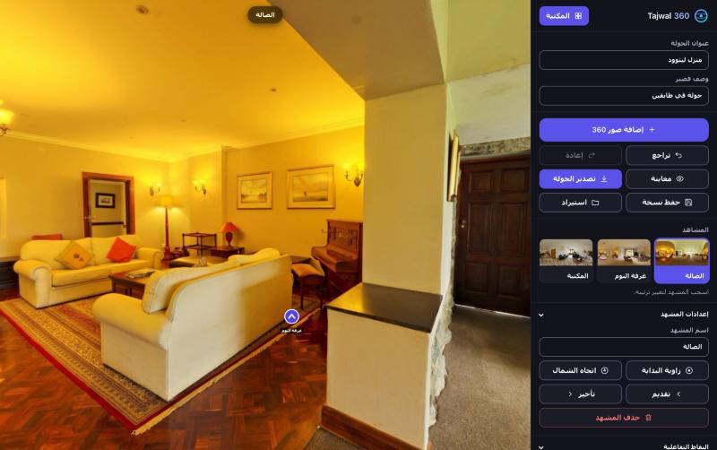

# Tajwal 360

A 360° virtual tour builder that runs entirely in the browser. No server, no database,
no account. Panoramas are never uploaded anywhere — they stay in the visitor's own
browser, and finished tours are downloaded as a single self-contained HTML file.

**[Open the studio →](https://yousef-dev921.github.io/tajwal-360/)**



The interface is available in Arabic (RTL) and English (LTR), with a light/dark/auto
theme switch. Both choices are remembered in `localStorage` and applied before the
first paint, so there is no flash of the wrong theme or direction on a return visit.

## Why there is no backend

Hosting is static files only, which has three consequences worth stating plainly:

- **Privacy.** Images never leave the device. There is no data to breach, no privacy
  policy to write, and no retention obligations.
- **Cost.** Any free static host serves it, regardless of how many people use it.
- **Offline.** Three.js is vendored locally, so there is no CDN dependency.

The trade-off is real: work lives in one browser profile. Clearing site data, using
private browsing, or switching devices loses the project. The app surfaces this —
it warns when storage is unavailable, when the quota is nearly full, and periodically
reminds you to download a backup.

## Features

**Editing** — multiple panoramas by picker or drag-and-drop, images wider than 4096px
downscaled automatically; link hotspots and info hotspots in six shapes with adjustable
colour and size; drag hotspots directly in the panorama; 60 steps of undo/redo; scene
thumbnails with drag reordering; nadir patch to cover the tripod; background audio;
a floor plan with a scene marker per position; generated iframe embed code; per-scene
start angle and north direction.

**Interface** — Arabic and English, switched from the panel header; every string lives in
one dictionary in `app.js` and the static markup is translated through `data-i18n`
attributes. Switching language sets `lang` and `dir` on the document and re-renders the
dynamic parts. A three-state theme control (auto, light, dark) sets `data-theme` on the
document; auto follows the operating system. An exported tour is rendered in the language
its author was using and carries no switcher.

**Viewing** — walkthrough transitions that turn toward the hotspot, push in, and cross-fade
while preserving heading; a start screen built from the first scene; neighbouring scenes
preloaded; pinch zoom on touch and wheel zoom on desktop; full keyboard control; device
gyroscope; WebXR VR mode with an in-headset info panel.

**Storage** — a project library with thumbnails and timestamps; autosave with explicit
failure reporting; export to a standalone HTML tour; save and import projects as `.json`.

## How projects are stored

IndexedDB database `vrtour`, object store `k`:

| Key | Contents |
| --- | --- |
| `idx` | Project list: title, scene count, timestamp, thumbnail |
| `p:<id>` | Project document **without image bytes** |
| `b:<id>:<sceneId>` | Panorama as a binary `Blob` |
| `a:<id>` | Audio track as a `Blob` |
| `last` | Most recently opened project |

Splitting images out of the document matters more than it looks. Autosave runs on every
edit, including each keystroke in the title field. With images inline the whole project
was rewritten every time; a two-scene project wrote ~180 KB per keystroke. The document
is now about 4 KB and only changed images are written. Storing images as `Blob`s rather
than base64 strings also removes the 33% encoding overhead.

Projects written by older builds are migrated automatically on first load.

## Project file format

```json
{
  "v": 1,
  "lang": "ar",
  "title": "Tour title",
  "desc": "Short description",
  "nadir": { "img": "data:image/png;base64,...", "r": 25 },
  "audio": { "src": "data:audio/mpeg;base64,...", "name": "track.mp3", "vol": 0.6 },
  "plan":  { "img": "data:image/jpeg;base64,..." },
  "eurl": "https://...",
  "auto": false,
  "walk": true,
  "scenes": [{
    "id": "abc123",
    "name": "Entrance",
    "img": "data:image/jpeg;base64,...",
    "th":  "data:image/jpeg;base64,...",
    "u0": 0.8, "p0": 0, "n": 0.25,
    "pp": { "x": 0.4, "y": 0.6 },
    "hs": [{
      "id": "x1", "type": "link", "to": "<sceneId>",
      "label": "", "text": "", "shape": "arrow",
      "color": "#4f46e5", "size": 1, "u": 0.84, "v": 0.6
    }]
  }]
}
```

`lang` is the interface language an exported tour opens in (`ar` or `en`); the editor
ignores it on import and keeps its own choice. `u` and `v` are equirectangular coordinates from 0 to 1 — `u` horizontally from the left
edge, `v` vertically from the top. `u0` and `p0` are the starting yaw and pitch, `n` is
the north offset, and `v` at the root is the schema version.

## Development

No build step. Serve the directory over HTTP:

```bash
python3 -m http.server 8000
```

Opening `index.html` directly shows the editor, but export will not work: it reads
`app.js`, `style.css` and `three.min.js` with `fetch`, which `file://` blocks.

```
index.html          markup, icon sprite, content security policy
boot.js             applies the stored theme and language before the first paint
style.css           design tokens, light and dark themes, RTL and LTR layout
app.js              editor, viewer, storage and the Arabic/English dictionary
vendor/three.min.js Three.js r128 (MIT)
```

When changing `app.js`, `boot.js` or `style.css`, bump the `?v=` query in `index.html`.
Without it, returning visitors keep the cached copy.

## Deployment

Static files at the root of any host. This repository is deployed to GitHub Pages from
`main`. HTTPS is required — the gyroscope and WebXR will not start without it — and
GitHub Pages, Cloudflare Pages and Netlify all provide it on free tiers.

## Accessibility

Colour pairs are checked numerically: text at 4.5:1 or better (WCAG 1.4.3), control
borders and focus rings at 3:1 or better (WCAG 1.4.11). Touch targets are 44px on
coarse pointers (WCAG 2.5.5). The panorama is fully keyboard operable, status messages
are announced through `aria-live`, and `prefers-reduced-motion` is respected.

## Limitations

- An exported tour carries about 633 KB of fixed code, mostly Three.js, before any
  imagery, and embeds panoramas as base64. A 15-scene tour reaches tens of megabytes.
- Autosave does not work in private browsing. The app says so rather than failing quietly.
- Safari may evict site storage after a period without visits. Keep `.json` backups.
- Re-exporting is required after changing a scene name or north direction; previously
  exported files are not updated.
- **VR mode and the gyroscope have not been tested on real hardware.** Verify them
  before relying on either.

## Roadmap

ZIP export with binary images to cut tour size, a trimmed viewer bundle that omits editor
code, direct-to-disk saving via the File System Access API, per-scene audio, a view cone
on the floor plan, and more interface languages.

## Licence

[MIT](LICENSE). Three.js is bundled under the MIT licence, copyright 2010-2021 Three.js Authors.
